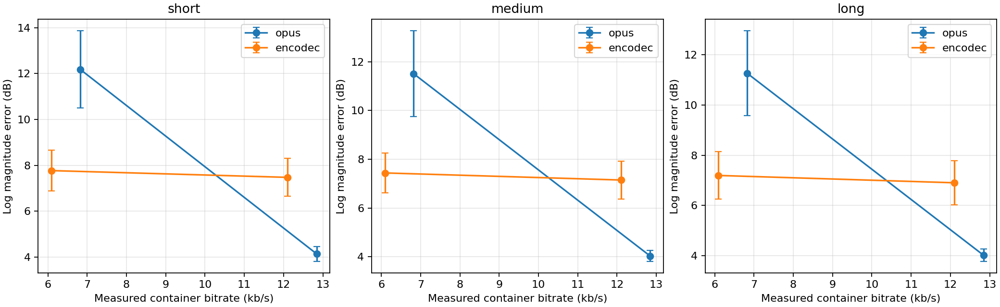
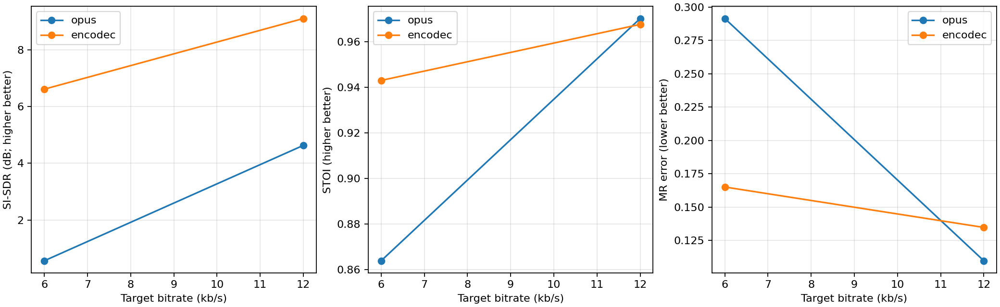
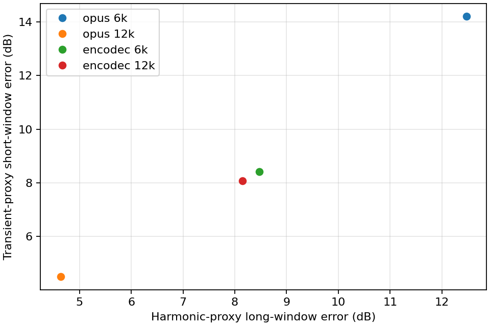
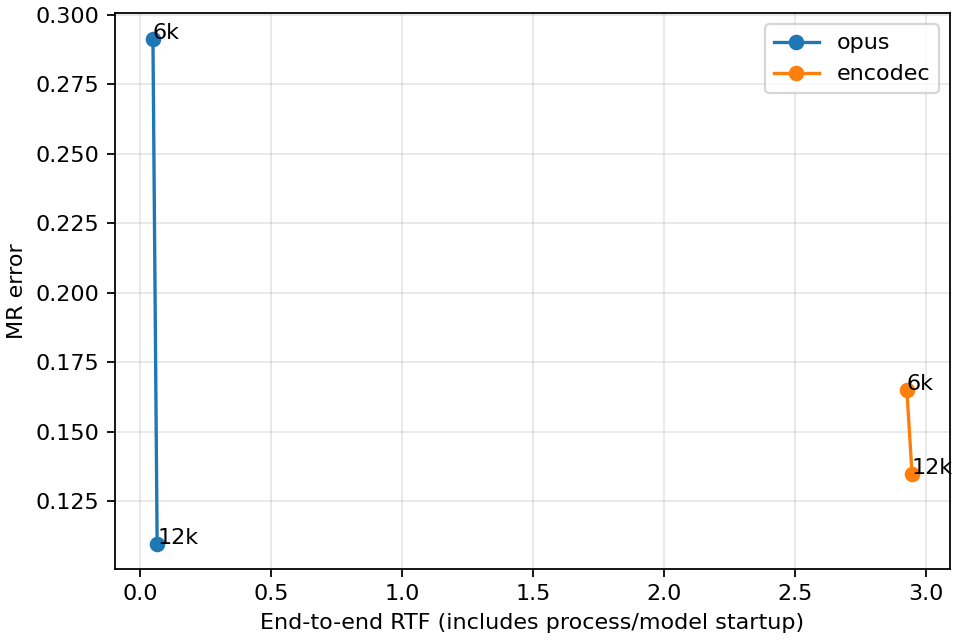

# Real speech experiment — executed Python/SciPy analysis

12 LibriSpeech dev-clean utterances, six speakers, four actual codec conditions each. No model training.
**These results were computed in Python/SciPy/pystoi, not MATLAB.** MATLAB Online verification remains separate.

| Codec | Target kb/s | Measured kb/s | SI-SDR dB | STOI | MR error | End-to-end RTF |
|---|---:|---:|---:|---:|---:|---:|
| opus | 6 | 6.824 | 0.569 | 0.8638 | 0.2914 | 0.050 |
| opus | 12 | 12.842 | 4.631 | 0.9703 | 0.1097 | 0.066 |
| encodec | 6 | 6.091 | 6.610 | 0.9431 | 0.1650 | 2.925 |
| encodec | 12 | 12.101 | 9.098 | 0.9677 | 0.1347 | 2.945 |

## Diagnostic comparison
Medium-only versus MR changes the codec ordering in 0 of 24 utterance/bitrate pairs.
Short- versus long-window log-magnitude errors disagree in ordering in 0 of 24 pairs.
These observed counts do not establish perceptual benefit or a new metric.

## Limitations
LibriSpeech sources are 16 kHz, resampled once to 24 kHz; information above 8 kHz is not original speech.
Automatic reference-only acoustic proxies; harmonicity, spectral flux, high-band energy; not forced alignment or phonetic ground truth.
Single serial end-to-end subprocess runs, including model/process startup; development workload not an isolated performance benchmark.
5000 paired speaker-cluster resamples, seed 5305; six speakers only; exploratory intervals, no multiple-comparison claims.
Target rates are matched; container rates differ. Inspect measured rates before attributing differences to codec architecture.
Speakers/utterances are a small deterministic development subset, not a representative population or a listening study.

