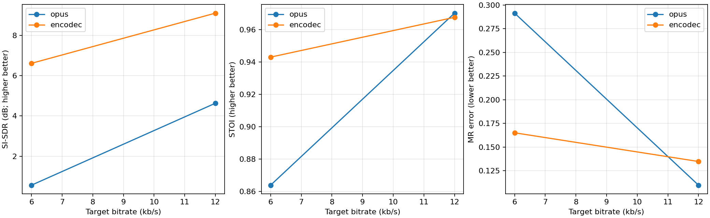
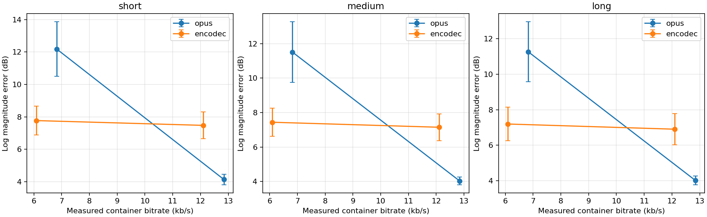
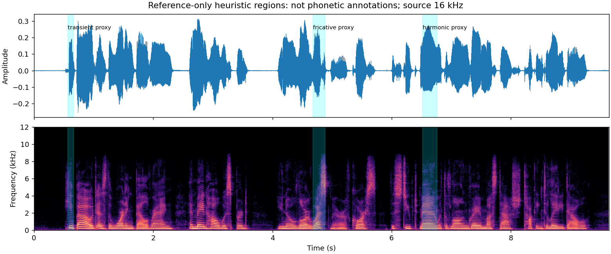
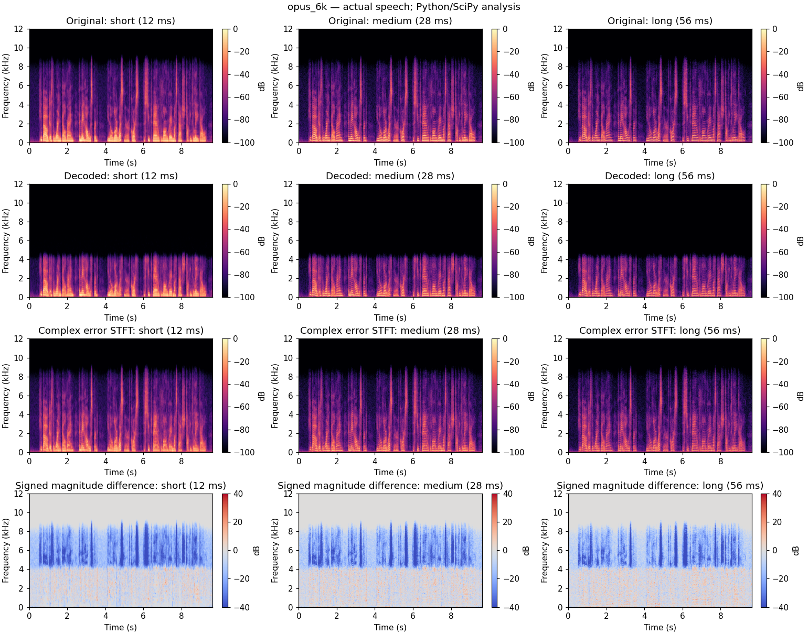
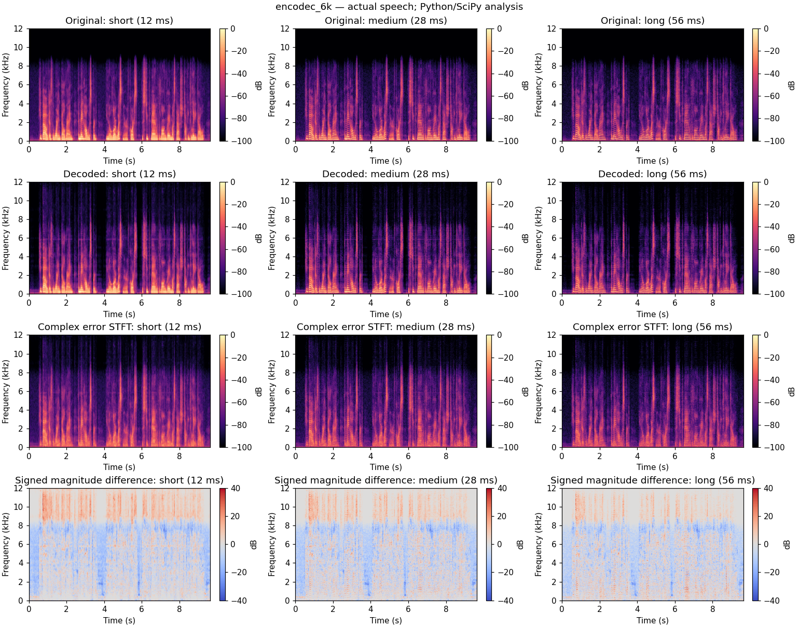
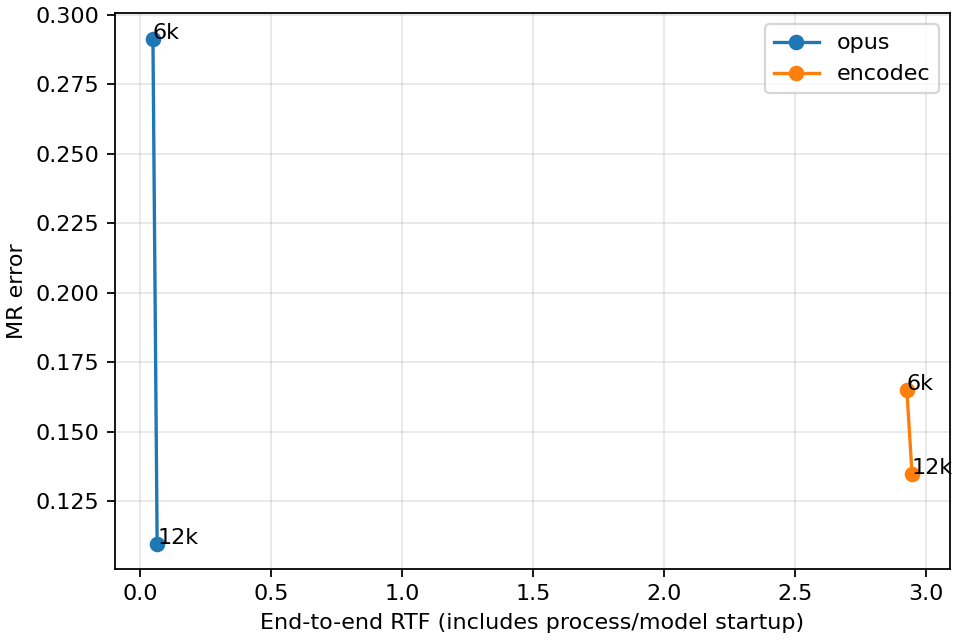

# Executed real-speech experiment results

**Analysis runtime: Python/SciPy/pystoi. Core `.m` functions also executed under GNU Octave. Native MATLAB tests, toolbox calls and rendering are NOT yet verified.**

## Data and protocol
LibriSpeech dev-clean: 12 utterances, six speakers, 82.33 s total; source files are 16-kHz read English speech. Each prepared reference is mono 24 kHz with common -3 dB gain. No independent output gain fitting or local alignment is used.
The archive matched the official MD5. Selection was deterministic and outcome-blind: first three eligible IDs per corpus F/M label, first two 4–10-s recordings per speaker in archive order. This is a small development subset, not a population-representative benchmark or a training-overlap audit.
The same reference waveform goes to standard Opus and pretrained EnCodec at requested 6 and 12 kb/s. Versions, commands, source/output hashes, sample counts, clipping flags and timings are retained in provenance.

## Actual software validation
- 60 exact-source STFT/ISTFT reconstruction cases under GNU Octave 10.3.0: maximum absolute error 1.33e-15; invalid NOLA rejected.
- 48 real-speech conditions × nine numerical metrics compared between Python and the exact repository `.m` functions run in Octave: all 432 discrepancies below 1e-9; observed maximum below 8e-13.
- Five independent Python numerical tests passed: SciPy STFT/frame parity at all scales, known waveform and spectral errors, hash tampering and STOI identity. The earlier four codec integration tests also passed.
- 48 primary real codec outputs and 24 extra bitrate-matched Opus outputs were actually encoded/decoded. All primary outputs retained the reference sample count. The report does not assert that MATLAB Online ran.

## Primary requested-rate comparison
Means over 12 utterances; SDs and availability are in summary.csv. STOI is a computational intelligibility-related reference, not a listening score.

| Codec | Target kb/s | File kb/s | SI-SDR dB | STOI | MR error | End-to-end RTF |
|---|---:|---:|---:|---:|---:|---:|
| opus | 6 | 6.824 | 0.569 | 0.8638 | 0.2914 | 0.050 |
| opus | 12 | 12.842 | 4.631 | 0.9703 | 0.1097 | 0.066 |
| encodec | 6 | 6.091 | 6.610 | 0.9431 | 0.1650 | 2.925 |
| encodec | 12 | 12.101 | 9.098 | 0.9677 | 0.1347 | 2.945 |

## Actual-rate-matched sensitivity control
Opus includes more container overhead. To avoid treating equal targets as equal actual rates, choose an Opus CBR request from three adjacent 400-bps settings using encoded size only. No quality outcome is used to select the request. The EnCodec output stays unchanged.

| EnCodec rate class | Opus file kb/s | EnCodec file kb/s | Mean relative gap | Opus SI-SDR | EnCodec SI-SDR | Opus STOI | EnCodec STOI | Opus MR | EnCodec MR |
|---|---:|---:|---:|---:|---:|---:|---:|---:|---:|
| 6 | 6.021 | 6.091 | 1.16% | 0.794 | 6.610 | 0.8728 | 0.9431 | 0.2883 | 0.1650 |
| 12 | 12.040 | 12.101 | 0.50% | 4.430 | 9.098 | 0.9642 | 0.9677 | 0.1189 | 0.1347 |

The mean ordering by SI-SDR and MR error is retained in this size-matched control. The small 12-kb/s STOI ordering changes: this prevents a robust claim that nominal-rate Opus has higher intelligibility. A lower requested Opus rate does not improve every metric monotonically; do not assume monotonic quality or infer its cause from these data alone.

## Frequency-band sensitivity
The original source is 16 kHz: 24-kHz resampling does not create original speech information above 8 kHz. Repeat spectral evaluation over 0–8 kHz and report 4–8-kHz energy changes separately.

| Design | Codec | Rate class | 0–8-kHz MR error | Mean 4–8-kHz energy ratio (dB) |
|---|---|---:|---:|---:|
| primary | opus | 6 | 0.3134 | -16.00 |
| primary | opus | 12 | 0.1160 | -0.96 |
| primary | encodec | 6 | 0.1658 | -1.41 |
| primary | encodec | 12 | 0.1349 | -1.34 |
| matched_rate | opus | 6 | 0.3117 | -21.18 |
| matched_rate | opus | 12 | 0.1253 | -0.57 |

The mean MR ordering remains after restricting the analysis to original-source bandwidth. At the 6-kb/s rate class, Opus attenuates 4–8-kHz energy more strongly than EnCodec on this subset; this describes band energy, not necessarily perceived quality or true fricative identity. At 12 kb/s, SI-SDR favours EnCodec while spectral diagnostics favour Opus: one scalar does not describe every signal property.

## Global-lag sensitivity (primary conditions only)

A ±50-ms full-utterance cross-correlation search found best lags between -3 and +1 samples (maximum 0.125 ms at 24 kHz). EnCodec had a zero best lag in all 24 cases. These are inferred correlation lags, not independently measured codec delays.
Primary scores and WAVs remain unshifted; only this supplementary check trims a single constant lag. No regional time warping is used.

| Codec | Target kb/s | Mean raw SI-SDR dB | Mean best-global-lag SI-SDR dB | Maximum absolute lag (samples) |
|---|---:|---:|---:|---:|
| opus | 6 | 0.569 | 0.723 | 3 |
| opus | 12 | 4.631 | 7.289 | 3 |
| encodec | 6 | 6.610 | 6.610 | 0 |
| encodec | 12 | 9.098 | 9.098 | 0 |

At 12 kb/s the inferred constant-lag adjustment raises Opus SI-SDR substantially, so the raw margin must not be described entirely as codec waveform damage. EnCodec still has higher mean SI-SDR in this primary lag-sensitivity check. Rate matching and lag sensitivity were separate checks; their combined effect has not been evaluated.

## Multi-resolution modification and regional evidence
Compare a medium-only diagnostic with the three-resolution score while holding data/codecs fixed. In the primary experiment there were **0/24 medium-versus-MR ranking changes** and **0/24 short-versus-long log-error ranking changes**. Thus this subset provides no evidence that extra resolutions improve overall codec ranking. Do not invent a positive result.
Reference-only heuristics selected 12 harmonic proxies, 12 transient proxies and 5 high-frequency/fricative proxies. They are acoustic proxies, not human phonetic annotations. Missing fricative candidates are retained as missing, not forced.
Detector details: 25-ms frames/10-ms hop; energy gate at 4% of maximum frame power; lag-normalised autocorrelation over 60–300 samples (80–400 Hz); 200-ms smoothing; harmonic score threshold 0.55; fricative proxy uses 4–8-kHz energy, periodicity <0.5 and score threshold 0.035; transient proxy maximises positive spectral flux. Regions are fixed before inspecting codec errors.

## Paired uncertainty
Differences below are EnCodec minus Opus for primary requested-rate conditions. Bootstrap resamples six speaker clusters (two utterances each), 5000 times, seed 5305. These are exploratory 95% intervals on a small fixed subset, not population guarantees or corrected significance tests.

| Target | Metric | Mean paired difference | Speaker-cluster interval |
|---|---|---:|---|
| 6 | si_sdr_db | 6.0411 | [5.1517, 6.7902] |
| 6 | stoi | 0.0793 | [0.0685, 0.0904] |
| 6 | mr_error | -0.1264 | [-0.1451, -0.1058] |
| 12 | si_sdr_db | 4.4663 | [2.9106, 6.3000] |
| 12 | stoi | -0.0026 | [-0.0049, -0.0001] |
| 12 | mr_error | 0.0250 | [0.0165, 0.0338] |

## Runtime and limitations
RTF is serial same-machine CPU subprocess wall time including process/model loading and file I/O. Model download is excluded. Neural torch threads are 1. This is a single-pass implementation measurement under a development workload, not an isolated or steady-state inference benchmark. No paper runtime is directly compared.

Additional limitations: six speakers, English read speech only, no listening study, no training-overlap audit, heuristic regions, no native MATLAB UI/toolbox execution, fixed score weights/floors, no packet loss and no neural-enhanced Opus condition. Spectral magnitudes ignore phase; SI-SDR ignores scale/polarity. These limits explain why a universal codec winner is not supported.

## Reproduction
See repository README, scripts/select_speech.py, run_corpus.py, analyse_corpus.py, rate_matched_control.py, inband_sensitivity.py and the downloadable MATLAB Online data ZIP. Dataset attribution and exact IDs are in data_provenance. Source-code acknowledgements and course AI-use declarations remain required.
